<div align="center">

# AWS Custom VPC with Bastion Host and NAT Gateway

**A hands-on build of a custom AWS network from scratch: public and private subnets, route tables, Internet Gateway, bastion host and NAT Gateway.**


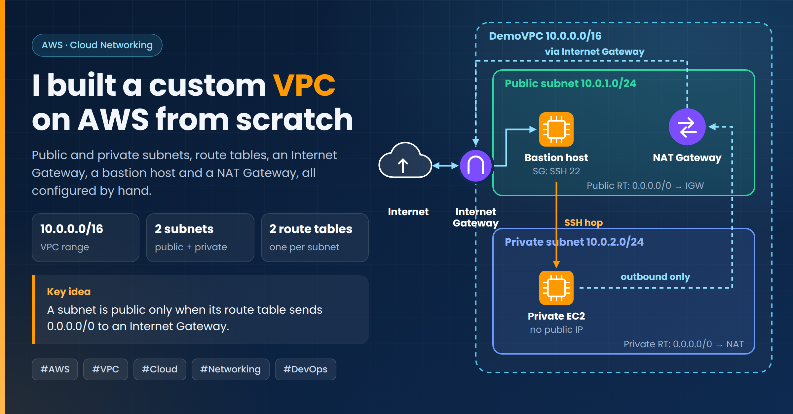

</div>

---

## Overview

Instead of using the default VPC, I designed and built my own network in AWS and tested it end to end. The goal was to understand exactly what makes a subnet **public** or **private**, and how traffic moves between the internet, a bastion host and a private instance.

> **Key idea:** A subnet is public only when its route table sends `0.0.0.0/0` to an Internet Gateway.

## What I built

| Component | Configuration |
|---|---|
| VPC | `DemoVPC`, `10.0.0.0/16` |
| Public subnet | `10.0.1.0/24` |
| Private subnet | `10.0.2.0/24` |
| Route tables | One public, one private, each associated with its subnet |
| Internet Gateway | Attached to the VPC, route `0.0.0.0/0 → IGW` in the public route table |
| Public EC2 (bastion host) | Amazon Linux 2023, `t3.micro`, SSH (port 22) allowed |
| Private EC2 | Amazon Linux 2023, `t3.micro`, no public IP |
| NAT Gateway | In the public subnet, route `0.0.0.0/0 → NAT` in the private route table |

## Traffic flow

```
Internet ⇄ Internet Gateway ⇄ Public subnet (bastion host, NAT Gateway)
                                      │
                                      ├── SSH hop ──► Private subnet (private EC2)
                                      │
                       Private EC2 ──► NAT Gateway ──► Internet (outbound only)
```

---

## Step-by-step walkthrough

### 1. Create the VPC

Created `DemoVPC` with the IPv4 CIDR block `10.0.0.0/16`.

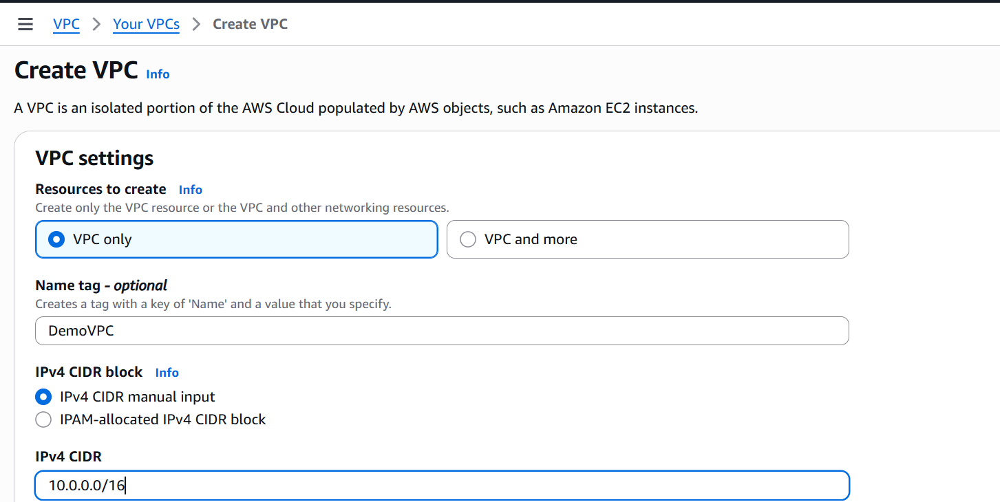

### 2. Create the subnets and associate the public subnet

Created a public subnet (`10.0.1.0/24`) and a private subnet (`10.0.2.0/24`), then associated the public subnet with the public route table.

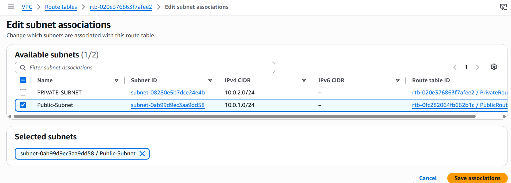

### 3. Create the route tables

Created a separate route table for each subnet.

**Public route table**

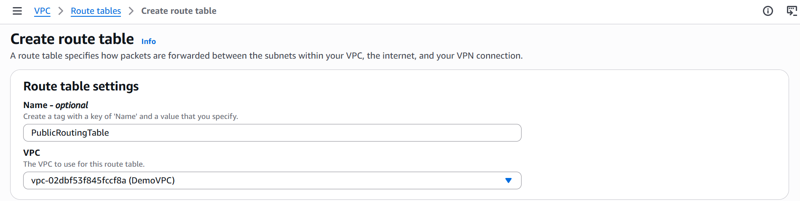

**Private route table**

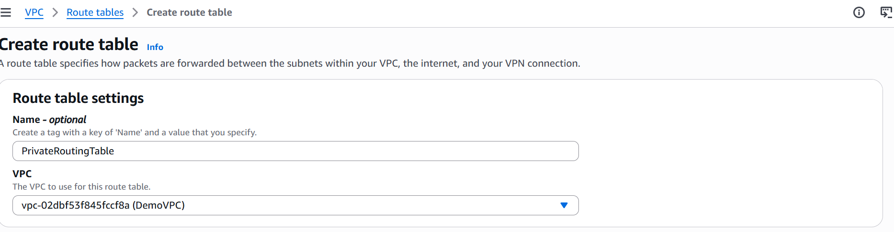

### 4. Create and attach the Internet Gateway

Created the Internet Gateway, then attached it to `DemoVPC`.

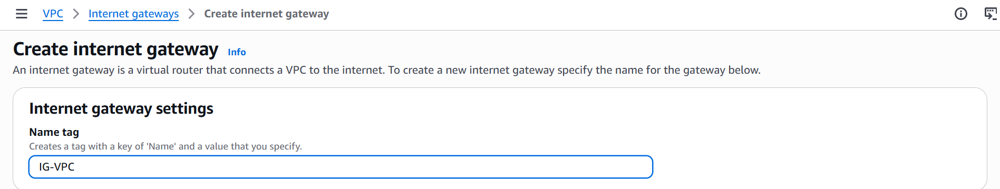

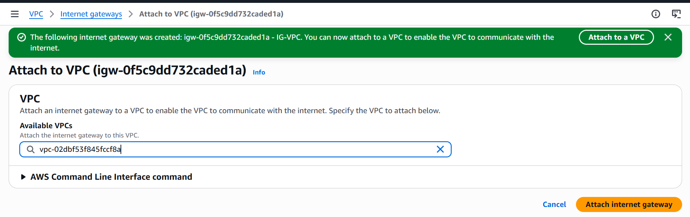

### 5. Add the internet route to the public route table

Added the route `0.0.0.0/0 → Internet Gateway` to the public route table. This single route is what makes the subnet public.


### 6. Launch the public EC2 instance and connect over SSH

Launched an EC2 instance in the public subnet with auto-assign public IPv4 enabled and a security group that allows SSH on port 22. After the Internet Gateway route was in place, the SSH connection succeeded.

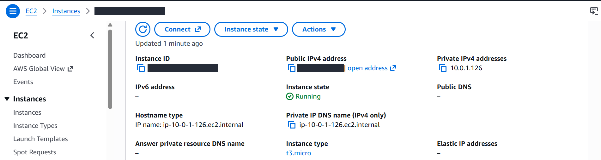

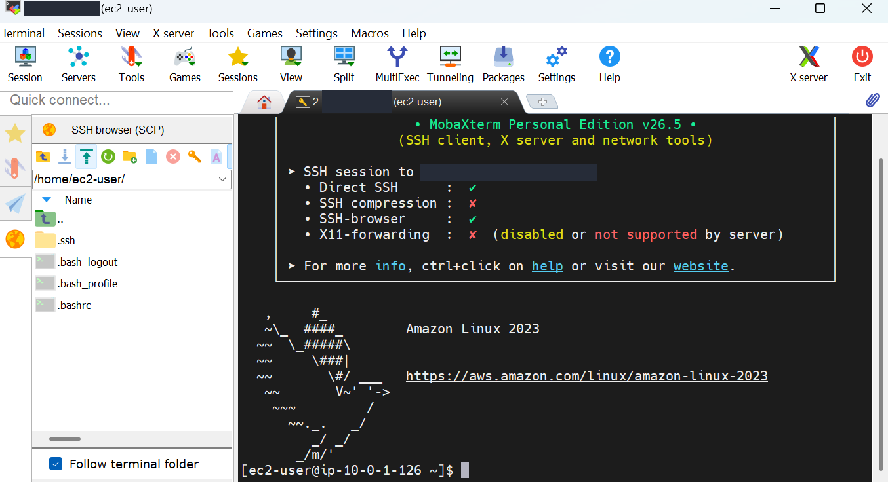

### 7. Launch the private EC2 instance

Launched a second instance in the private subnet. It has no public IPv4 address, so it can't be reached from the internet directly.


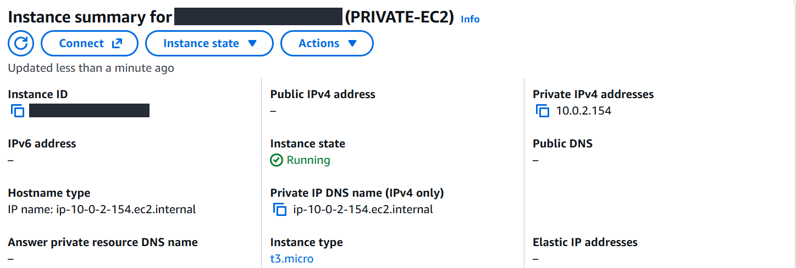

### 8. Reach the private instance through the bastion host

Copied the key pair to the bastion host and connected to the private instance from there. The bastion host is the only way in.

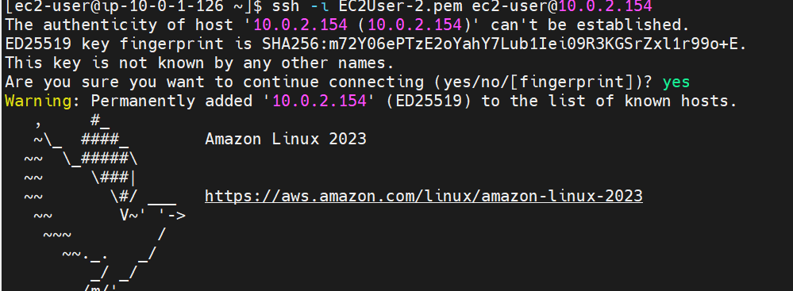

### 9. Add a NAT Gateway for outbound internet access

Created a NAT Gateway in the public subnet and added the route `0.0.0.0/0 → NAT Gateway` to the private route table.

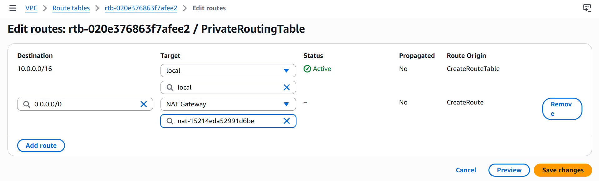

### 10. Verify outbound connectivity from the private instance

From the private instance, a ping to `8.8.8.8` succeeds. The instance can reach the internet, but the internet can't start a connection to it.

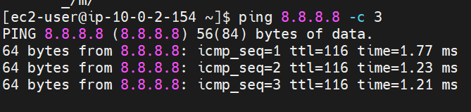

---

## Problem and fix

| Before | After |
|---|---|
| The instance was in a subnet named "public" and had a public IP, but SSH timed out. | After adding `0.0.0.0/0 → Internet Gateway` to the public route table, SSH connected. |

**Why:** a public IP is not enough. Without a route to an Internet Gateway, packets have no path out of the subnet. The name of the subnet doesn't matter, the route table does.

## Key takeaways

- A subnet is **public** only if its route table has a route to an Internet Gateway.
- A **private** subnet has no direct route to the internet, which keeps its instances isolated.
- A **bastion host** gives controlled SSH access to private instances.
- A **NAT Gateway** gives private instances outbound-only internet access, for example for updates.
- Each subnet needs to be explicitly associated with the right route table.

## Tools and services

`Amazon VPC` · `Amazon EC2` · `Internet Gateway` · `NAT Gateway` · `Route Tables` · `Security Groups` · `Amazon Linux 2023` · `SSH (MobaXterm)`

## Cleanup

To avoid charges, remove the resources when finished. The NAT Gateway and its Elastic IP are billed while they exist.

1. Terminate both EC2 instances
2. Delete the NAT Gateway, then release its Elastic IP
3. Detach and delete the Internet Gateway
4. Delete the subnets and route tables
5. Delete `DemoVPC`

## Possible improvements

- Add a second Availability Zone for high availability
- Restrict the bastion host's SSH access to my own IP
- Enable VPC Flow Logs to monitor traffic
- Recreate the setup with Terraform or the AWS CLI

---

<div align="center">

**Built by [Iman Naseer](https://github.com/Iman-Naseer)**

If you found this useful, feel free to give the repo a ⭐

</div>
